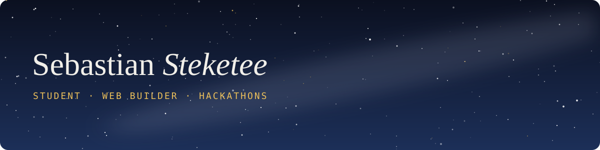

### Hi, I'm Sebastian

High school student who builds things for the web, often at hackathons.

---

### Featured projects

#### [Layover](https://layoverapp.vercel.app)
*Built with a team of four at the Into the Skies hackathon*

When a flight is delayed or cancelled, Layover shows what's now at risk in the rest of the trip, gives a checklist of what to do, and writes the update for the people waiting on you.

  
  
  

`Next.js` · `React` · `TypeScript` · `Tailwind` · [Try it](https://layoverapp.vercel.app) · [Code](https://github.com/namishchopra11/layover)

#### [Dark Nights Project](https://seb-stek.github.io/DarkNightsProject/)
*Solo project*

A concept site for a nonprofit that organizes monthly neighborhood light switch-offs so people can go outside and see the stars.

- Interactive light pollution simulator for the Bortle scale
- Live, zoomable map of upcoming Dark Nights
- An illustrated street you can switch off to watch the Milky Way appear

`HTML` · `CSS` · `JavaScript` · `Leaflet` · [Visit the site](https://seb-stek.github.io/DarkNightsProject/) · [Code](https://github.com/Seb-Stek/DarkNightsProject)

---

### What I build with

`HTML` · `CSS` · `JavaScript` · `TypeScript` · `React` · `Next.js` · `Tailwind` · `Leaflet` · `Git`
